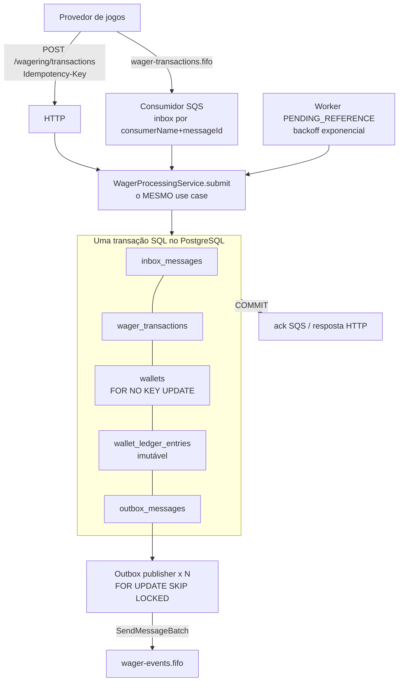
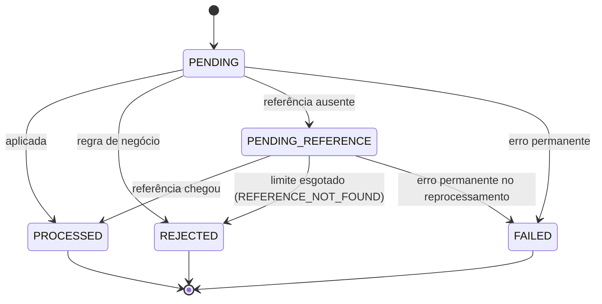

# ARCHITECTURE

Decisões, trade-offs e limitações do **Distributed Wagering Processor**. O enunciado
original está em [`docs/CHALLENGE.md`](docs/CHALLENGE.md). Os diagramas UML do sistema estão em
[`docs/uml/Modelo UML.md`](docs/uml/Modelo%20UML.md).

Sumário

1. [Visão geral](#1-visão-geral)
2. [Camadas e fronteiras](#2-camadas-e-fronteiras)
3. [Modelo de domínio](#3-modelo-de-domínio)
4. [Persistência: ORM, `Money` e transações](#4-persistência-orm-money-e-transações)
5. [Garantias no schema](#5-garantias-no-schema)
6. [Concorrência](#6-concorrência)
7. [Idempotência](#7-idempotência)
8. [Referências fora de ordem](#8-referências-fora-de-ordem)
9. [SQS: consumidor, retry e DLQ](#9-sqs-consumidor-retry-e-dlq)
10. [Transactional outbox](#10-transactional-outbox)
11. [API HTTP e mapa de status](#11-api-http-e-mapa-de-status)
12. [Códigos de falha](#12-códigos-de-falha)
13. [Observabilidade](#13-observabilidade)
14. [Autenticação](#14-autenticação)
15. [Interpretações adotadas](#15-interpretações-adotadas)
16. [Testes](#16-testes)
17. [Trade-offs e limitações](#17-trade-offs-e-limitações)

---

## 1. Visão geral



Cada processo da aplicação é idêntico e sem estado em memória que importe para a correção.
Os papéis em segundo plano (consumidor SQS, publisher da outbox, worker de referências) podem
ser ligados ou desligados por instância (`ENABLE_*`). Tudo que garante correção mora no
PostgreSQL: unicidade, travas de linha, constraints e triggers.

## 2. Camadas e fronteiras

```
src/
  shared/domain/        Money, erros de domínio, IntegrationEvent, uuidv7, Clock
  wallet/domain/        Wallet (aggregate root), WalletLedgerEntry
  wagering/domain/      WagerTransaction (máquina de estados), FailureCode, eventos
  messaging/domain/     InboxMessage, OutboxMessage
  application/          use cases + portas (UnitOfWork, repositórios, EventPublisher, Metrics, Logger)
  infrastructure/       adaptadores: PostgreSQL (MikroORM), SQS, HTTP (Nest), observabilidade, workers
  auth/                 ponto de extensão de autenticação (no-op)
  composition.ts        monta os serviços sem Nest (usado pelo Nest e pelos testes)
```

- **Domínio** não importa Nest, MikroORM nem SDK da AWS. Construtores são `private`; a criação
  passa por factories (`create`, `open`, `from`, `enqueue`, `receive`) e a reconstrução a partir
  do banco por `rehydrate`, que não revalida transições.
- **Aplicação** conhece só portas (`application/ports.ts`). `WagerProcessingService` é o único
  caminho para aplicar uma transação: HTTP, SQS e o worker de referências chamam o mesmo código.
- **Infraestrutura** implementa as portas. O Nest é só a casca HTTP/DI: os serviços são montados
  por `buildCore()` e podem rodar sem ele (é assim que os testes de integração sobem várias
  "instâncias" no mesmo processo).

## 3. Modelo de domínio

### Money
- Valor guardado como **`bigint` em centavos** (escala fixa 2). Nenhum `number` toca dinheiro:
  entrada e saída são strings decimais, aritmética é inteira e exata.
- `Money.from` é o contrato de entrada: rejeita `NaN`, `Infinity`, notação científica, vazio,
  sinal explícito, separadores, mais de 2 casas, negativos e valores acima de `numeric(18,2)`.
  Aceita `"25"` e `"25.5"` e normaliza para `"25.00"`/`"25.50"`.
- `Money.fromSigned` existe só para valores derivados que podem ser negativos (a `difference`
  da reconciliação). Operações entre moedas diferentes lançam `CurrencyMismatchError`.
- O modelo é multi-moeda; os testes usam `BRL` e cobrem conflito com `USD`.

### Wallet
- `Wallet.open()` cria com `version = 1` e devolve o lançamento `CREDIT` de abertura quando o
  saldo inicial é positivo. Saldo inicial nunca existe sem ledger.
- `debit()`/`credit()` devolvem o `WalletLedgerEntry` correspondente: saldo e ledger mudam juntos
  por construção. `version` só incrementa quando o saldo muda (LOSS e rejeições não mexem).
- `debit()` lança `InsufficientFundsError`; o use case consulta `canDebit()` antes para escolher o
  código certo (`INSUFFICIENT_FUNDS` para BET, `REVERSAL_WOULD_OVERDRAW` para reversões).

### WagerTransaction



- Transições fora da tabela lançam `InvalidTransactionStateError` (erro de programação).
  O banco reforça: uma trigger proíbe `UPDATE`/`DELETE` de linhas em estado terminal.
- `OPENING` só nasce por `createOpening()` (interno). `create()` rejeita `OPENING` e exige
  `referenceExternalTransactionId` em `REFUND`/`ROLLBACK`.
- `ledgerDirectionFor(reference)`: BET debita; WIN, REFUND e OPENING creditam; ROLLBACK é o
  inverso do lançamento da referência (ROLLBACK de BET credita, de WIN ou REFUND debita).
- `checkReference(reference)` concentra as regras de coerência (provider, player, wallet, moeda,
  rodada, tipo aceito e valor igual em reversões).
- `resultBalance` guarda o saldo observado no momento do resultado; é ele que o replay devolve.
- `FAILED` é usado quando o reprocessamento de uma `PENDING_REFERENCE` falha de forma
  permanente: sem isso, a mesma linha voltaria ao worker a cada ciclo (poison pill).

### WalletLedgerEntry
Só campos `readonly` e nenhum método de mutação. `create()` valida
`balanceBefore ± money === balanceAfter` e não aceita saldos negativos.

### Inbox, Outbox e eventos
`InboxMessage` e `OutboxMessage` seguem o esqueleto do enunciado. `OutboxMessage.enqueue(event)`
usa o `eventId` como id da outbox. Os eventos são subclasses de `IntegrationEvent<T>` com
`eventType` e `version` no tipo e `data` em JSON puro (`MoneyProps`, nunca `Money`).

## 4. Persistência: ORM, `Money` e transações

**MikroORM (preferencial no enunciado), usado como Unit of Work transacional e runner de
migrations, sem mapear o domínio como entidades.**

- A fronteira transacional é `EntityManager.transactional()`: BEGIN/COMMIT/ROLLBACK reais, em
  `READ COMMITTED`. Qualquer exceção desfaz tudo (inbox, transação, wallet, ledger, outbox).
- Os repositórios executam **SQL explícito** pela conexão da transação corrente
  (`em.getConnection().execute(sql, params, 'all', em.getTransactionContext())`) e reidratam
  com `rehydrate()`.

Por que não mapear entidades e usar Identity Map/`flush`:
1. O núcleo depende de construções que o ORM não expressa bem: `INSERT ... ON CONFLICT DO
   NOTHING RETURNING`, `FOR NO KEY UPDATE`, `FOR UPDATE SKIP LOCKED`, `NOT EXISTS` correlato na
   outbox. Escrever isso à mão deixa cada lock e cada ida ao banco explícitos e revisáveis.
2. O domínio fica sem decorators e sem tipos do ORM, como o enunciado pede, sem uma camada
   dupla de entidades de persistência para manter em sincronia.
3. O custo é perder change tracking automático. Aqui ele não ajuda: cada caso de uso escreve
   poucas linhas conhecidas, e a ordem das escritas importa (ver §6).

**Mapeamento do `Money`:** duas colunas, `amount numeric(18,2)` e `currency char(3)`. O driver
devolve `numeric` como string, que vira `Money.from({ amount, currency })` sem passar por float.
`numeric(18,2)` comporta 16 dígitos inteiros; `Money` rejeita valores acima disso na entrada.

**Migrations:** versionadas e reversíveis (`up`/`down`) com `@mikro-orm/migrations`, cada uma em
transação. O teste `schema.test.ts` aplica tudo, reverte até o zero (sem sobrar tabela nem
função) e aplica de novo.

## 5. Garantias no schema

| Garantia | Mecanismo |
|---|---|
| Uma wallet por `playerId` + `currency` | `UNIQUE (player_id, currency)` |
| Saldo nunca negativo | `CHECK (balance >= 0)`, `numeric(18,2)` |
| Operação única por provedor | `UNIQUE (provider_id, external_transaction_id)` |
| Idempotency key única (por provedor) | `UNIQUE (provider_id, idempotency_key)` |
| REFUND/ROLLBACK têm referência | `CHECK (kind NOT IN ('REFUND','ROLLBACK') OR reference_external_transaction_id IS NOT NULL)` |
| Uma referência é revertida no máximo uma vez | índice único parcial em `reference_transaction_id` `WHERE kind IN ('REFUND','ROLLBACK') AND status = 'PROCESSED'` |
| Estado coerente | `CHECK`s: falha ⇔ `failure_code`; `PROCESSED` ⇔ `processed_at` e `result_balance`; `PENDING_REFERENCE` ⇒ `next_attempt_at` |
| Estado terminal imutável e transação não apagável | trigger `BEFORE UPDATE OR DELETE` |
| Ledger imutável | triggers `BEFORE UPDATE OR DELETE` e `BEFORE TRUNCATE` |
| No máximo um lançamento por transação e wallet | `UNIQUE (transaction_id, wallet_id)` |
| Aritmética do lançamento | `CHECK (balance_after = balance_before ± amount)` conforme a direção |
| Ledger sem buracos | trigger `BEFORE INSERT`: `balance_before` = `balance_after` do último lançamento da wallet |
| **Saldo materializado = ledger** | *constraint trigger* `DEFERRABLE INITIALLY DEFERRED`: no COMMIT, `wallets.balance` deve ser igual ao último `balance_after` (O(1) pelo índice `(wallet_id, seq)`) |
| Dedup de mensagens | `PRIMARY KEY (consumer_name, message_id)` na inbox |
| Outbox eficiente | índices parciais `WHERE published_at IS NULL` em `(seq)` e `(ordering_key, seq)` |

As duas últimas linhas do ledger fecham o invariante "toda alteração de saldo tem lançamento e
vice-versa" **no banco**: um `UPDATE wallets` sem o lançamento correspondente não passa no COMMIT,
mesmo vindo de fora da aplicação (há teste para isso).

## 6. Concorrência

A unidade de concorrência é a `walletId`. Não existe lock global.

**Estratégia: lock pessimista da linha da wallet com `SELECT ... FOR NO KEY UPDATE`**, dentro da
transação, antes de ler o saldo. Todas as mutações de uma wallet ficam serializadas; wallets
diferentes andam em paralelo.

Por que pessimista:
- Wallets quentes (muitas apostas na mesma wallet) são o caso normal de um cassino. Com lock
  otimista, sob contenção, quase toda tentativa perde e refaz; o pessimista forma uma fila
  ordenada sem trabalho desperdiçado.
- O `UPDATE` condicional (`WHERE balance >= x`) resolveria o débito, mas o use case precisa ler
  o saldo para montar o ledger, validar referências e checar "já revertida" de forma atômica.
  A linha travada torna tudo isso uma seção crítica simples.
- A coluna `version` continua existindo e o `UPDATE` usa `WHERE version = ?` como defesa em
  profundidade: se o lock falhasse por bug, o lost update viraria erro, não dinheiro errado.

**Por que `FOR NO KEY UPDATE` e não `FOR UPDATE`.** O teste de hot wallet travou com
`FOR UPDATE`. O `INSERT` em `wager_transactions` toma `FOR KEY SHARE` na wallet (checagem da
FK); depois a mesma transação pedia `FOR UPDATE`, que conflita com o `KEY SHARE` das outras.
Duas transações nessa situação esperavam uma pela outra. `FOR NO KEY UPDATE` serializa quem
altera o saldo e é compatível com as checagens de FK.

**Ordem de locks (sem deadlock):** submissão = insere a própria linha de transação → trava a
wallet. Reprocessamento = trava a linha `PENDING_REFERENCE` (`SKIP LOCKED`) → trava a wallet,
uma linha por transação SQL. O "acordar dependentes" depois de uma BET usa `SKIP LOCKED` para
nunca esperar por uma linha que um worker já segura. Mesmo assim, deadlock (`40P01`) e falha
de serialização (`40001`) são tratados como `ConcurrencyConflictError` e a transação inteira é
refeita (até 6 tentativas no total, com backoff e jitter).

**SQS FIFO é otimização.** `MessageGroupId = walletId` mantém ordem por wallet no consumo, mas
a correção não depende disso: a API HTTP nem passa pela fila, e o banco garante as invariantes
em qualquer ordem de chegada.

## 7. Idempotência

- O header `Idempotency-Key` é obrigatório e é a fonte da verdade (padrão sugerido:
  `providerId:externalTransactionId`). Na fila, vem em `data.idempotencyKey`, com o mesmo padrão
  quando ausente.
- **`payloadHash` = SHA-256 (hex) do JSON canônico** dos campos de negócio: `providerId`,
  `externalTransactionId`, `playerId`, `walletId`, `roundId`, `gameId`, `kind`, `money`
  e `referenceExternalTransactionId`. JSON canônico = chaves ordenadas recursivamente, sem
  espaços, `undefined` omitido. O hash é calculado **depois** de normalizar o dinheiro
  (`"25"` e `"25.00"` geram o mesmo hash). Header e metadados de transporte ficam de fora.
- O caminho é `INSERT ... ON CONFLICT DO NOTHING RETURNING id`. Se a linha não foi criada:
  - mesma chave e mesmo hash → **replay**: devolve o resultado gravado (status, `failureCode`
    e o `resultBalance` daquele momento) com `idempotentReplay: true`;
  - mesma chave e hash diferente → **409 `IDEMPOTENCY_CONFLICT`**, nunca replay;
  - mesmo `externalTransactionId` com outra chave → também conflito.
- Concorrência entre duplicatas: com uma inserção da mesma chave ainda não confirmada, o
  `ON CONFLICT` do PostgreSQL **espera** o COMMIT da primeira e então devolve "já existe". As 49
  cópias de uma aposta enviada 50 vezes em paralelo esperam a original e respondem replay.
- Rejeições também são idempotentes: a transação `REJECTED` fica gravada e o reenvio devolve a
  mesma rejeição, sem reavaliar o saldo atual.
- Nenhuma idempotência depende de memória: são todas unicidades do schema.

## 8. Referências fora de ordem

- REFUND/ROLLBACK (e WIN/LOSS que tragam referência) cuja referência ainda não existe, ou existe
  mas ainda não foi processada, viram `PENDING_REFERENCE` (HTTP 202) e emitem
  `WagerTransactionPendingReference`.
- Um **worker agendado** (`PollingWorker`, em todas as instâncias com o papel ligado) pega uma
  linha vencida por vez com `FOR NO KEY UPDATE SKIP LOCKED` e roda o mesmo `apply()`.
- **Backoff exponencial:** `delay = min(PENDING_MAX_DELAY_MS, PENDING_BASE_DELAY_MS × 2^tentativa)`.
  Padrão: base 5s, teto 300s, **8 tentativas**, ou seja, cerca de 15 minutos de espera
  (5+10+20+40+80+160+300+300 s). Justificativa: o atraso normal entre BET e REFUND fora de
  ordem é de segundos (reentrega ou corrida entre filas); 15 minutos cobrem uma indisponibilidade
  curta do provedor sem deixar uma reversão pendurada por horas. Os valores são configuráveis.
- **Atalho:** quando uma BET/WIN/REFUND é processada, as transações que esperavam por ela são
  "acordadas" (`next_attempt_at = now`) na mesma transação, então normalmente a resolução não
  espera o backoff.
- Esgotado o limite: `REJECTED` com `REFERENCE_NOT_FOUND` e evento `WagerTransactionRejected`.

## 9. SQS: consumidor, retry e DLQ

- Long polling com no máximo `SQS_CONSUMER_CONCURRENCY` mensagens em andamento. Mensagens do
  mesmo `MessageGroupId` (wallet) que chegam no mesmo lote são processadas **em sequência**;
  grupos diferentes em paralelo.
- Cada mensagem chama `WagerProcessingService.submit` com o registro de inbox
  `(consumerName, messageId)` dentro da **mesma transação** do efeito financeiro. Mensagem
  repetida encontra a inbox e devolve o resultado original, sem novo efeito. O mesmo
  `messageId` com corpo diferente é tratado como erro permanente.
- **`DeleteMessage` (ack) só depois que o use case retornou**, ou seja, depois do COMMIT.
- Classificação:

| Situação | Ação |
|---|---|
| Sucesso, rejeição de negócio, duplicata | ack |
| Erro transitório (PostgreSQL fora, deadlock esgotado, timeout, erro desconhecido) | não confirma; `ChangeMessageVisibility` com backoff `base × 2^tentativa` (até 300s) |
| Erro permanente (malformada, payload inválido, wallet inexistente, conflito de idempotência) | envia para `wager-transactions-dlq.fifo` com o motivo e só então apaga |
| Tentativas esgotadas (`SQS_MAX_RECEIVE_COUNT`) | DLQ com `RETRIES_EXHAUSTED` |

- O redrive nativo da fila (`maxReceiveCount + 1`) é só rede de segurança para quando o
  processo morre antes de classificar.
- Se uma mensagem do grupo volta para retry, as seguintes do mesmo grupo no lote também voltam,
  para não passar na frente dela.
- **Shutdown (`SIGTERM`):** para de buscar (aborta o long poll), não começa mensagens novas,
  devolve a visibilidade das que estavam no lote sem começar e espera as que estão em andamento
  (até 25s). Só então o pool do banco é fechado.
- **Morte depois do COMMIT e antes do ack:** a mensagem reaparece após o visibility timeout, a
  inbox reconhece e o ack acontece sem novo débito. Testado com um processo real que se encerra
  exatamente nesse ponto (`FAULT_CRASH_AFTER_COMMIT=true`, usado só em teste).

## 10. Transactional outbox

- Eventos são gravados em `outbox_messages` **na mesma transação** do fato financeiro. Nada é
  publicado antes do COMMIT.
- O publisher (em qualquer número de instâncias) pega um lote com `FOR UPDATE SKIP LOCKED`
  (cada linha vai para um publisher só), publica com `SendMessageBatch` (10 por chamada), marca
  `published_at` e faz COMMIT.
- **Ordem por wallet:** `ordering_key` (= `walletId`) vira o `MessageGroupId`. Se um evento falha,
  ele entra em backoff (`attempts`, `next_attempt_at`, `last_error`) e o `lockDue` não entrega os
  eventos seguintes da mesma wallet enquanto houver um anterior em backoff.
- **Entrega at-least-once:** se o processo morre entre publicar e o COMMIT, a linha volta a ficar
  pendente e o evento é publicado de novo **com o mesmo `eventId`**. O SQS FIFO descarta a
  duplicata dentro da janela de 5 minutos (`MessageDeduplicationId = eventId`) e, fora dela, o
  consumidor deduplica por `eventId`. `WalletBalanceChanged` traz `walletVersion` para ordenar.

Eventos: `WagerTransactionProcessed` (inclusive LOSS e OPENING), `WagerTransactionRejected`,
`WalletBalanceChanged` (só quando o saldo muda) e `WagerTransactionPendingReference`, publicados
em `wager-events.fifo`.

## 11. API HTTP e mapa de status

O mesmo mapa vale para todos os endpoints. O corpo de erro é sempre
`{ "error": { "code", "message", "retryable" }, "correlationId" }`.

| Situação | Status | Pode reenviar? |
|---|---|---|
| Transação aplicada (primeira vez) | **201** | não precisa |
| Replay idêntico de transação aplicada | **200** (`idempotentReplay: true`) | é idempotente |
| Rejeição de negócio (corpo traz `failureCode` e `advice`) | **422** | não: resultado definitivo |
| Aceita, aguardando referência | **202** | não precisa: será resolvida |
| Payload/parâmetro inválido, header ausente, cursor inválido | **400** | só corrigindo |
| Wallet ou transação inexistente | **404** | não |
| Conflito de idempotência, wallet duplicada | **409** | não |
| Falha transitória de infraestrutura | **503** + `Retry-After` | sim, com a **mesma** chave |
| `FAILED` ou erro inesperado | **500** | analisar |

O ledger é paginado por `cursor` opaco (base64url do `seq` identity do último item) e `limit`
(1–200, padrão 50). O cursor é estável: lançamentos novos entram depois e nunca deslocam páginas.

## 12. Códigos de falha

| Código | Quando | `advice` ao provedor |
|---|---|---|
| `INSUFFICIENT_FUNDS` | BET maior que o saldo | `GIVE_UP` |
| `REVERSAL_WOULD_OVERDRAW` | ROLLBACK que deixaria saldo negativo (ex.: WIN já gasto) | `CONTACT_SUPPORT` |
| `REFERENCE_NOT_FOUND` | referência não chegou dentro do limite | `FIX_PAYLOAD` |
| `REFERENCE_NOT_PROCESSED` | referência existe mas foi REJECTED/FAILED | `GIVE_UP` |
| `REFERENCE_MISMATCH` | provider, player, wallet, moeda ou rodada diferentes | `FIX_PAYLOAD` |
| `REFERENCE_KIND_INVALID` | tipo não aceito (REFUND→WIN, ROLLBACK→LOSS...) | `FIX_PAYLOAD` |
| `AMOUNT_MISMATCH` | valor diferente do da referência | `FIX_PAYLOAD` |
| `ALREADY_REVERSED` | a referência já foi revertida | `GIVE_UP` |
| `CURRENCY_MISMATCH` | moeda da operação ≠ moeda da wallet | `FIX_PAYLOAD` |
| `PLAYER_WALLET_MISMATCH` | `playerId` não é o dono da wallet | `FIX_PAYLOAD` |
| `INTERNAL_PERMANENT_ERROR` | estado `FAILED` | `CONTACT_SUPPORT` |

`FIX_PAYLOAD` significa corrigir e reenviar com uma **nova** idempotency key (a antiga já tem um
resultado gravado). Erros de contrato (400) usam códigos próprios: `INVALID_PAYLOAD`,
`INVALID_MONEY`, `MISSING_IDEMPOTENCY_KEY`, `MISSING_REFERENCE` etc.

## 13. Observabilidade

- **Logs** JSON (pino) com `correlationId` em toda linha (AsyncLocalStorage), além de
  `messageId`, `transactionId`, `walletId` e `providerId` onde se aplicam. Valores monetários
  não são logados (há `redact` como defesa extra e um teste que confere).
  `X-Correlation-Id` é aceito e devolvido; na fila, o correlationId é o da mensagem (ou o `messageId`).
- **Métricas** Prometheus em `GET /metrics`:

| Métrica | O que mede |
|---|---|
| `wager_transactions_total{kind,status}` | transações por status |
| `wager_duplicates_detected_total{source}` | replays e mensagens repetidas |
| `wager_idempotency_conflicts_total` | mesma chave com payload diferente |
| `wager_retries_total{reason}` | retries (conflito de banco, SQS, outbox) |
| `sqs_dlq_messages_total{reason}` | mensagens na DLQ |
| `wallet_lock_conflicts_total`, `wallet_lock_wait_seconds` | disputa por lock de wallet |
| `wager_processing_duration_seconds{source}` | latência (http, sqs, pending) |
| `outbox_lag_seconds`, `outbox_pending_messages` | lag da outbox (calculado no scrape) |
| `outbox_published_total`, `outbox_publish_failures_total` | publicação |
| `wager_pending_reference_total{outcome}` | resolução de referências |
| `reconciliation_divergences_total` | divergências de reconciliação |

- **Health:** `/health/live` (processo vivo, sem dependências) e `/health/ready` (PostgreSQL e
  SQS alcançáveis, 503 se não). Ambos sem autenticação.

## 14. Autenticação

**Decisão: não implementada** (vale zero pontos e competiria com o núcleo financeiro).

Ponto de extensão: `src/auth/auth.guard.ts` registra um `NoopAuthGuard` global e define o
`ProviderIdentityPort`. O desenho pretendido:

1. Um IdP externo (Keycloak no Docker Compose) emite tokens OIDC para cada provedor
   (client credentials) com uma claim `provider_id`.
2. O guard valida assinatura (JWKS em cache), `iss`, `aud` e `exp`, e o `ProviderIdentityPort`
   transforma as claims em `ProviderIdentity`.
3. O use case passa a exigir `command.providerId === identity.providerId`, com 403 caso
   contrário. Rotas administrativas (criar wallet, reconciliação) exigem um papel próprio.
4. `/health/*` e `/metrics` ficam fora do guard. Mensagens SQS seguem como canal interno
   confiável, mas o `providerId` da mensagem continua passando pelas mesmas validações de domínio.

## 15. Interpretações adotadas

1. **Uma reversão por referência, de qualquer tipo.** O enunciado proíbe reverter duas vezes
   "pelo mesmo tipo"; a leitura literal permitiria um REFUND e um ROLLBACK da mesma BET, o que
   duplicaria o crédito e violaria a invariante global. O índice único vale para REFUND e
   ROLLBACK juntos. ROLLBACK de um REFUND continua possível (é outra referência).
2. **WIN e LOSS podem trazer referência** (opcional). Se trazem, ela é validada como a das
   reversões (mesma rodada etc., tipo BET) e, se ainda não chegou, a transação espera.
3. **Valores devem ser positivos** em todos os tipos, inclusive LOSS (o valor perdido).
4. **Referência pendente ou ainda não processada** é tratada como ausente (espera). Referência
   REJECTED/FAILED gera `REFERENCE_NOT_PROCESSED`.
5. **Wallet inexistente é erro de contrato (404 / DLQ), não rejeição persistida:** a transação
   não pode existir sem wallet (FK). Wallet existente de outro jogador é rejeição
   (`PLAYER_WALLET_MISMATCH`).
6. **Idempotency key é única por provedor** (`provider_id, idempotency_key`): chaves iguais de
   provedores diferentes não colidem.
7. **Conflito de idempotência na fila vai para a DLQ:** indica bug do produtor e precisa de
   análise; dar ack esconderia o problema.
8. **OPENING emite eventos** (`WagerTransactionProcessed` e `WalletBalanceChanged`), já que o
   saldo muda.

## 16. Testes

Todos rodam contra **PostgreSQL e SQS reais**. Nenhum teste substitui banco ou fila por mock.

| Suíte | Cobre |
|---|---|
| `test/unit` (95 testes) | `Money` (escala, aritmética exata, entradas inválidas), `Wallet` e ledger, máquina de estados e regras de referência, hash canônico, inbox/outbox |
| `integration/schema` | cada constraint, trigger e índice do §5; migrations up → down → up |
| `integration/atomicity` | falha no meio da transação não deixa nada; eventos gravados junto |
| `integration/business-rules` | REFUND, ROLLBACK, reversão que estoura saldo, mismatches |
| `integration/pending-reference` | fora de ordem, backoff exato (relógio controlado), esgotamento, FAILED |
| `integration/sqs-consumer` | inbox, redelivery, replay, DLQ por motivo, retry, ack perdido, shutdown, reinício |
| `integration/outbox` | publicação após commit, publishers concorrentes, ordem por wallet, crash antes de marcar |
| `integration/http-api` | todos os endpoints, mapa de status, cursor, health, métricas, logs |
| `concurrency/in-process` | 3 instâncias com pools próprios: 50× a mesma aposta, cenário §8 (10 rodadas), hot wallet, wallets em paralelo, reversões simultâneas |
| `concurrency/multi-process` | 3 processos `bun` reais: 50× via HTTP, §8, carga mista, SQS compartilhado, 3 publishers, referência entre processos, `kill -9` e reinício, crash depois do commit e antes do ack |

Cada arquivo cria um banco novo (migrations aplicadas) e filas com prefixo aleatório.
Invariante final: `assertLedgerMatchesBalances` confere `saldo == soma do ledger` em todas as wallets.

## 17. Trade-offs e limitações

- **Hot wallet tem teto de vazão.** O lock serializa a wallet: no teste de carga local, uma
  wallet com 20% do tráfego processou cerca de 74 transações/s, com p50 de 197ms nela, enquanto
  as demais ficaram em p50 de 5ms. É o preço da correção. Mitigações possíveis: menos idas ao
  banco com o lock (inserir os eventos em um único `INSERT`) ou sub-wallets (*buckets*) de saldo.
- **Ordem de eventos entre publishers concorrentes é melhor esforço.** Dentro de um lote e após
  falhas a ordem é mantida, mas dois publishers podem publicar eventos consecutivos da mesma
  wallet em paralelo. Consumidores devem deduplicar por `eventId` e ordenar por `walletVersion`.
- **Publisher segura a transação enquanto chama o SQS.** Simplifica a reivindicação das linhas,
  mas uma fila lenta prende conexões do pool (lote limitado por `OUTBOX_BATCH_SIZE`).
- **Sem reversão parcial**, conforme o enunciado.
- **O ambiente onde rodei os testes não tinha Docker**: validei com PostgreSQL 18 embutido e
  `moto` (emulador de SQS) no Windows. O `docker-compose.yml` usa PostgreSQL 16 e LocalStack,
  que não pude executar aqui. Diferenças conhecidas:
  - o `moto` degrada com filas FIFO grandes (141 → 43 msg/s em 600 mensagens), então o lag da
    outbox no teste de carga reflete o emulador, não a aplicação;
  - no Windows, `SIGTERM` encerra o processo sem hooks, então o shutdown gracioso foi testado
    chamando o mesmo código de parada no processo (`consumer.stop()`), não por sinal real.
    Em container Linux, o `CMD` em exec form entrega o sinal ao Bun e o Nest chama os hooks.
- **Reconciliação lê sob demanda** (soma do ledger). Com o ledger muito grande, convém
  reconciliar a partir de checkpoints. A *constraint trigger* já garante saldo = último
  `balance_after` a cada COMMIT.
