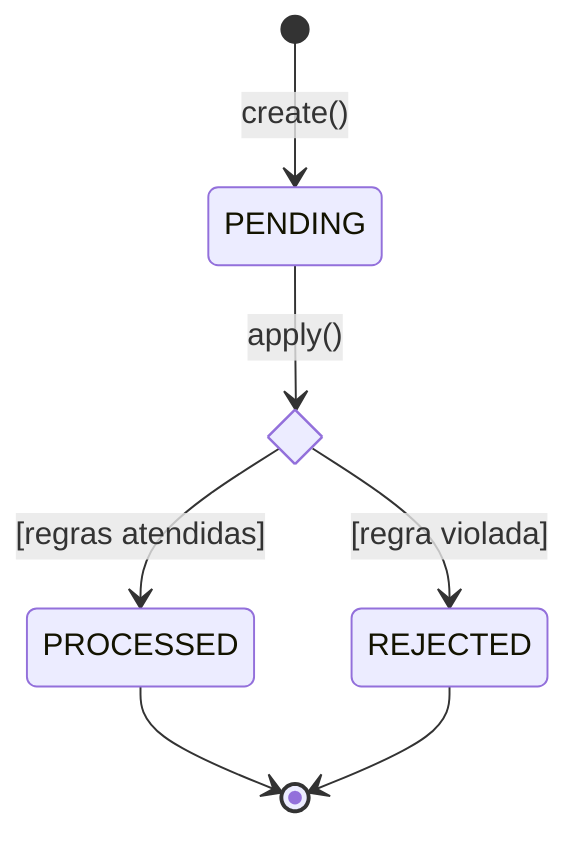
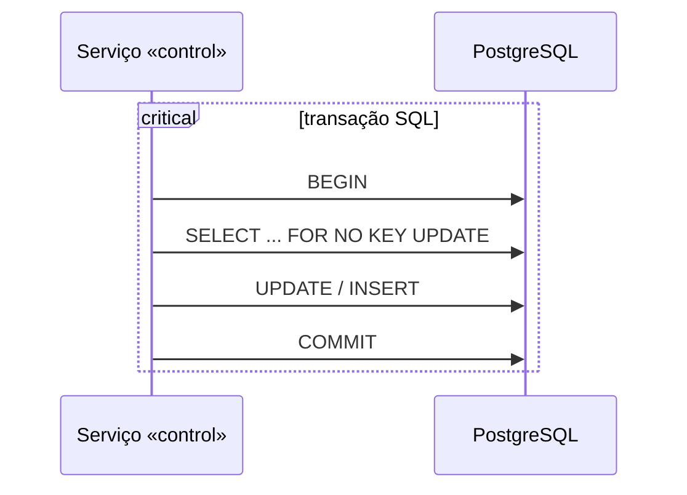

# Guia UML — o livro do Guedes resumido para o Wagering Processor

> Resumo do livro para conferir o modelo de um backend transacional sem reler as 650
> páginas. Adaptado do guia do SGF: lá o foco são telas e fluxos de processo; aqui são
> estados de transações, sequências entre camadas, atomicidade e concorrência.
> Quem usa: o [Agente UML](Agente%20UML.md) (`revisor-uml`), o Claude e quem revisa o código.
> O modelo atual fica em [Modelo UML](Modelo%20UML.md).
>
> Referências no formato **§seção (p. N)**. A página é a do PDF em
> `C:\Users\vitau\Documents\Livros\UML 2 - Uma Abordagem Pratica - Gilleanes T.A. Guedes.pdf`,
> não a do livro impresso. A seção vale para os dois.

## Qual diagrama responde qual pergunta

| Pergunta sobre o sistema | Diagrama | No livro |
|---|---|---|
| Quem usa o sistema e para quê (provedor, operação, tempo)? | Casos de uso | cap. 3 (p. 60) |
| Quais camadas existem e quem depende de quem? | Pacotes | §6.5 (p. 264) |
| Quais são as regras e os dados do domínio? | Classes | cap. 4 (p. 133) |
| Como o domínio vira tabela, e o que o banco garante? | Classes com `<<table>>` | §4.14-4.15 (p. 212-215) |
| Em que situação está uma transação, e para onde pode ir? | Máquina de estados | cap. 9 (p. 345) |
| Em que ordem API, serviço, repositório e banco conversam? | Sequência | cap. 7 (p. 267) |
| Como o processamento passa pelos responsáveis? | Atividade com partições | cap. 10, §10.22 |
| Quais peças existem e que interfaces trocam? | Componentes | cap. 12 (p. 451) |
| Onde cada peça roda? | Implantação | cap. 13 (p. 468) |

Um diagrama só mostra uma visão; usar vários é o que revela as falhas (§1.3, p. 32).

## 1. Classes (cap. 4)

| Elemento | Regra | No livro |
|---|---|---|
| Atributos e métodos | visibilidade `+` `-` `#`; `$` estático | §4.1 (p. 134) |
| Composição | o todo cria e possui a parte (`*--`); a parte não vive sem o todo | §4.2.5 (p. 147) |
| Generalização | subclasse herda (`<|--`), ex.: eventos de `IntegrationEvent` | §4.2.6 (p. 149) |
| Dependência | uma classe usa ou cria a outra sem guardá-la (`..>`) | §4.2.9 (p. 153) |
| Realização | uma classe implementa uma interface (`<|..`) | §4.2.10 (p. 154) |
| Interface fornecida / requerida | bola / soquete | §4.4 (p. 157-158) |
| Restrição | regra em `{ }` ou OCL | §4.5 (p. 159) |
| `<<enumeration>>` | lista fechada de valores (status, kinds, códigos) | §4.6.1 (p. 171) |
| `<<boundary>>` `<<control>>` `<<entity>>` | tela/entrada, coordenação, dados | §4.6.3-4.6.5 (p. 174-179) |
| Mapeamento em tabelas, `<<table>>`, FKs | como as classes viram schema | §4.15 (p. 213-215) |
| Padrão Repository | a aplicação pede objetos ao repositório, sem SQL espalhado | §4.16 (p. 228); §7.11 (p. 304) |

**Neste projeto:** controllers e o handler SQS são `<<boundary>>`; os serviços em
`src/application` são `<<control>>`; o domínio é `<<entity>>`. A boundary nunca fala com o
banco direto, e o domínio não conhece Nest, MikroORM nem AWS.

## 2. Máquina de estados (cap. 9)

| Elemento | Desenho | Regra |
|---|---|---|
| Estado | retângulo arredondado | de espera ou de processamento (§9.1, p. 345) |
| Transição | seta `evento [guarda] / ação` | sempre rotulada (§9.2, p. 346) |
| Inicial / final | círculo cheio / círculo com anel | (§9.3, §9.4, p. 347) |
| entry / exit / do | segunda divisão do estado | (§9.6, p. 349) |
| Autotransição | seta que volta ao estado | repetição com guarda, ex.: nova tentativa (§9.8, p. 352) |
| Escolha | losango | guardas cobrindo todos os casos (§9.9, p. 353) |
| Estado composto | estado com subestados | (§9.11, p. 357) |
| Estados ortogonais | regiões em paralelo | (§9.13, p. 360) |
| Junção | círculo pequeno | reúne ramos (§9.16, p. 363) |
| Ponto de saída | círculo com X na borda | exceção que interrompe o estado (§9.17, p. 364) |
| Término | X | fim forçado (§9.18, p. 366) |

**Neste projeto:** todo status gravado (`wager_transactions.status`) é uma
`<<enumeration>>` com máquina de estados. Cada transição no código (`transitionTo`) e cada
`CHECK`/trigger no banco precisa aparecer no diagrama, e vice-versa.

## 3. Sequência (cap. 7)

| Elemento | Regra | No livro |
|---|---|---|
| Lifeline e ator | cada participante numa coluna | §7.1-7.2 (p. 267-268) |
| Mensagem síncrona / de retorno | seta cheia / tracejada | §7.3.2-7.3.3 (p. 271-272) |
| Autochamada | mensagem para si mesmo | §7.3.6 (p. 275) |
| Mensagem assíncrona | seta aberta; quem envia não espera (filas) | §7.3.7 (p. 276) |
| Uso de interação (`ref`) | chama outro diagrama | §7.6 (p. 282) |
| `alt` | alternativas com guarda | §7.8 (p. 286) |
| `opt` | opcional | §7.8 (p. 288) |
| `par` | em paralelo (várias instâncias) | §7.8 (p. 290) |
| `loop` | repetição (polling, lote) | §7.8 (p. 291) |
| `break` | exceção que interrompe o fluxo normal | §7.8 (p. 291) |
| `critical` | região que não pode ser interrompida: a transação SQL | §7.8 (p. 292) |
| Invariante de estado | condição que vale num ponto da lifeline | §7.9 (p. 294) |

**Neste projeto:** a transação SQL é sempre um `critical`. Tudo que precisa ser atômico
(inbox, transação, saldo, ledger, outbox) fica dentro dele; publicar no SQS e dar ack ficam
fora, depois do COMMIT.

## 4. Atividade (cap. 10)

| Elemento | Regra |
|---|---|
| Nó inicial e final | um inicial; todo caminho termina (§10.4, §10.5, §10.9) |
| Decisão | toda saída com `[guarda]`; os ramos se reúnem ou terminam (§10.6) |
| Partição (raia) | cada ação na raia de quem a executa (§10.22) |
| Região interrompível | o que pode ser desfeito e até quando (§10.23) |
| Exceção | seta em raio até o tratador (§10.16) |

**Neste projeto:** a região interrompível é a transação SQL. Antes do COMMIT, qualquer falha
desfaz tudo; depois dele, nada volta atrás e o reenvio vira replay.

## 5. Componentes e implantação (cap. 12 e 13)

- Componente com interfaces **fornecidas** e **requeridas** (§12.2, p. 453); componentes
  internos e portas (§12.3, p. 454).
- Nós (`<<device>>`, `<<executionEnvironment>>`) e associações (§13.1-13.3, p. 468-471);
  artefatos implantados nos nós (§13.5, p. 473). Aqui: containers do `docker-compose.yml`.

## 6. Documentação viva

Toda mudança no sistema também muda o modelo; documentação desatualizada atrapalha mais
que nenhuma (§1.2.6, p. 30). O [Modelo UML](Modelo%20UML.md) registra o commit que descreve
e lista as divergências abertas.

## 7. Modelos em Mermaid

Máquina de estados:

~~~markdown

~~~

Sequência com transação SQL:

~~~markdown

~~~
