# Modelo UML do Distributed Wagering Processor

Diagramas do sistema como ele está no código, em Mermaid (o GitHub e o Obsidian desenham
sem plugin). As regras de notação estão no [Guia UML](Guia%20UML.md), com seção e página do
livro do Guedes. Quem revisa o modelo é o agente [`revisor-uml`](Agente%20UML.md).

Documentação viva (§1.2.6): mudou o código, muda este arquivo. O cabeçalho registra o
commit que o modelo descreve.

| # | Diagrama | Responde | Livro |
|---|---|---|---|
| 1 | Casos de uso | quem faz o quê | cap. 3 |
| 2 | Pacotes (camadas) | quem depende de quem | §6.5 |
| 3 | Classes do domínio | as regras e seus dados | cap. 4 |
| 4 | Classes da aplicação e portas | controle, interfaces e quem as realiza | §4.4, §4.6.3-4.6.5, §4.16 |
| 5 | Tabelas | o schema e suas garantias | §4.14-4.15 |
| 6 | Máquina de estados: WagerTransaction | para onde uma transação pode ir | cap. 9 |
| 7 | Máquina de estados: evento da outbox | publicação e retry | cap. 9 |
| 8 | Máquina de estados: mensagem SQS | ack, retry e DLQ | cap. 9 |
| 9 | Sequência: submeter pela API | a ordem das conversas numa aposta | cap. 7, §7.8 |
| 10 | Sequência: consumir do SQS | inbox e ack depois do COMMIT | cap. 7 |
| 11 | Sequência: referência fora de ordem | REFUND antes da BET | cap. 7 |
| 12 | Sequência: publicar a outbox | publishers concorrentes | cap. 7 |
| 13 | Atividade com partições | o processamento por responsável | cap. 10, §10.22 |
| 14 | Componentes | interfaces fornecidas e requeridas | cap. 12 |
| 15 | Implantação | onde cada parte roda | cap. 13 |

---

## 1. Casos de uso

Atores são papéis (§3.1). O **Tempo** dispara o reprocessamento e a publicação, como o ator
temporal dos exemplos do livro. `<<include>>` é obrigatório; `<<extend>>` é opcional e traz a
condição escrita (§3.8-3.11).

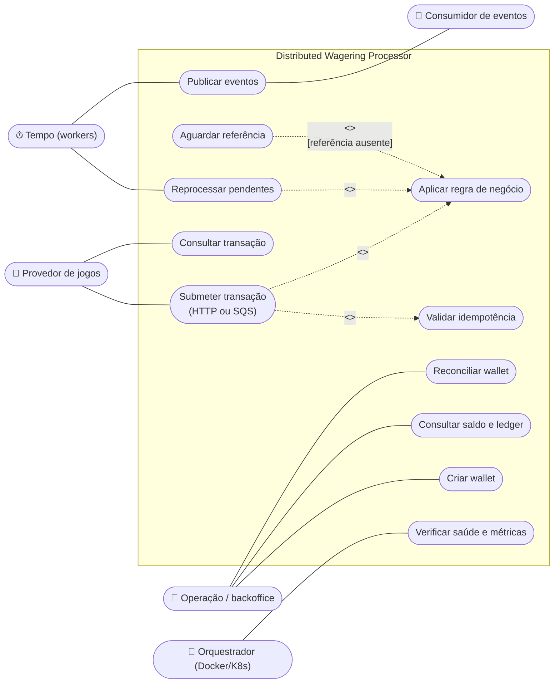

**Submeter transação: cenários (§3.4)**

| Cenário | Condição | Resultado |
|---|---|---|
| Principal | chave nova, regras atendidas | `PROCESSED`, saldo movimentado, 201 / ack |
| Alternativo | mesma chave e mesmo payload | resultado original, 200 / ack |
| Alternativo | referência ausente | `PENDING_REFERENCE`, 202 / ack |
| Exceção | regra de negócio violada | `REJECTED` com `failureCode`, 422 / ack |
| Exceção | mesma chave, payload diferente | 409 / DLQ, nada persistido |
| Exceção | payload inválido ou wallet inexistente | 400 ou 404 / DLQ, nada persistido |
| Exceção | PostgreSQL indisponível | 503 / retry com backoff |

Restrição (regra de negócio): saldo nunca negativo; cada referência é revertida uma única vez.

## 2. Pacotes (camadas)

Dependência sempre de fora para dentro (§6.2, §6.5). O domínio não depende de nenhum
pacote de framework.

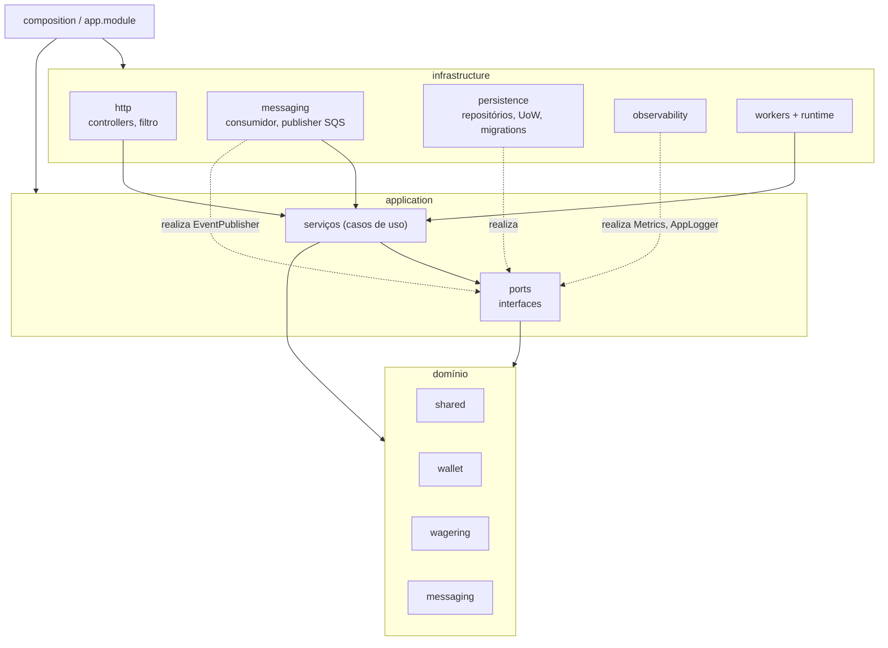

## 3. Classes do domínio

Construtor privado, criação por factories e `rehydrate` para reconstruir do banco.
`<<enumeration>>` conforme §4.6.1. `WalletLedgerEntry` só é criado por `Wallet` (dependência
`cria`, §4.2.9).

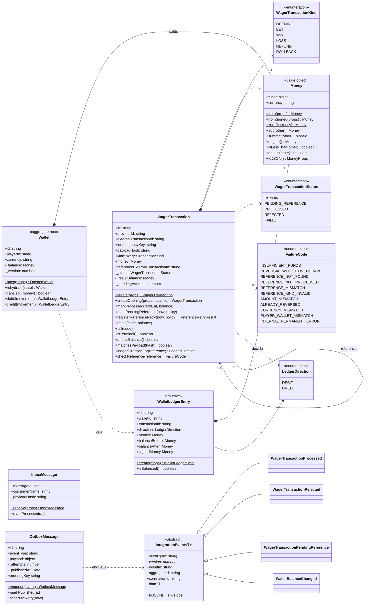

## 4. Classes da aplicação e portas

Camadas do livro: `<<boundary>>` fala com o ator, `<<control>>` coordena, `<<entity>>` é o
domínio (§4.6.3-4.6.5). Interfaces fornecidas e realizadas (§4.4, §4.2.10). Os repositórios
seguem o padrão Repository (§4.16, §7.11).

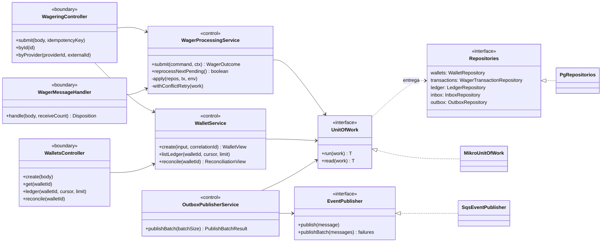

## 5. Tabelas

Mapeamento de classes em tabelas com o estereótipo `<<table>>` (§4.15.1) e chaves
estrangeiras (§4.15.2). As restrições escritas abaixo de cada tabela são as que o banco
garante sozinho.

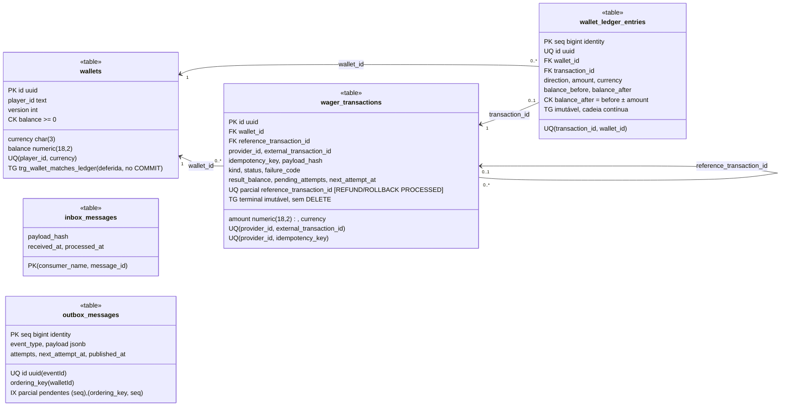

## 6. Máquina de estados: WagerTransaction

Fonte: `TRANSITIONS` em `src/wagering/domain/wager-transaction.ts`. A trigger
`trg_wager_transactions_terminal` impede no banco qualquer mudança depois de um estado final.
Autotransição para as tentativas de referência (§9.8); escolha com guardas completas (§9.9).

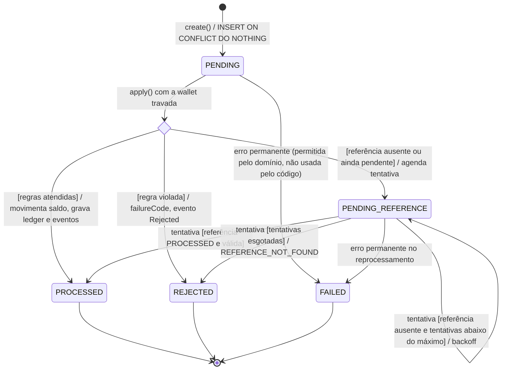

`PENDING` nunca é visível fora da transação SQL: a linha nasce e sai desse estado antes do
COMMIT. Para as outras transações, uma operação aparece já em um dos outros quatro estados.
`OPENING` nasce direto em `PROCESSED` (`createOpening`).

## 7. Máquina de estados: evento da outbox

Fonte: `OutboxMessage` e `OutboxPublisherService`.

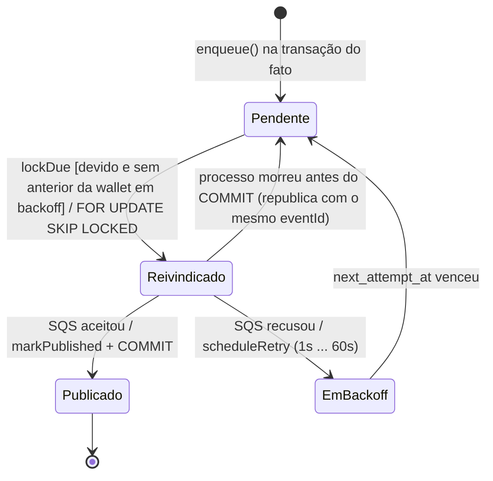

## 8. Máquina de estados: mensagem SQS no consumidor

Fonte: `SqsTransactionConsumer` e `WagerMessageHandler`. Ponto de saída para o caso de
falha do processo (§9.17).

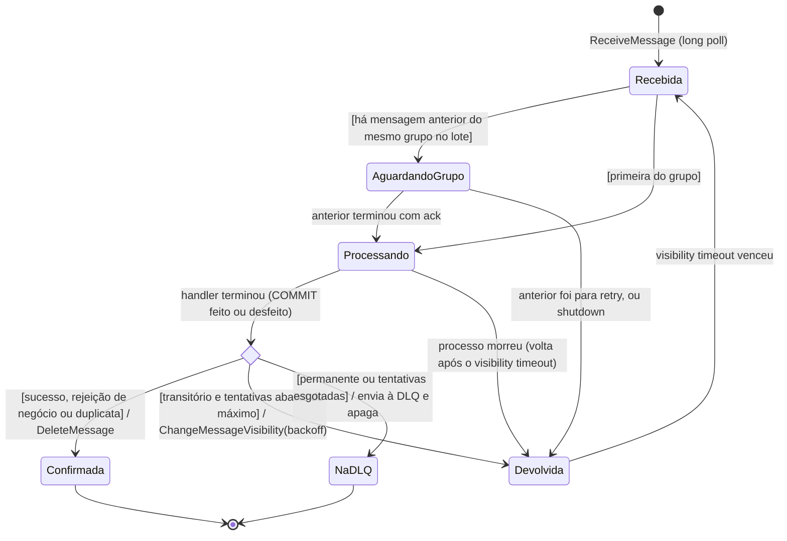

## 9. Sequência: submeter uma BET pela API

Caixa-branca (§7.10): entram tela, controle, repositórios e banco. O fragmento `critical`
(§7.8, p. 292) é a transação SQL: não pode ser interrompida pela metade. `alt` (p. 286)
para os desfechos. Mensagens de retorno tracejadas (§7.3.3).

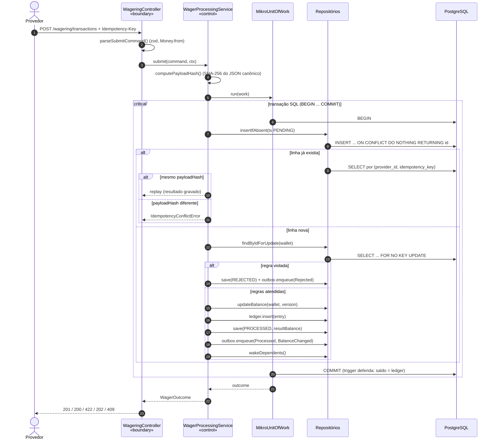

Deadlock ou falha de serialização dentro do `critical` desfaz tudo e o `withConflictRetry`
repete a transação inteira (até 6 tentativas).

## 10. Sequência: consumir uma mensagem do SQS

Mensagens assíncronas com seta aberta (§7.3.7). `break` (p. 291) para o erro permanente,
que interrompe o fluxo normal e vai para a DLQ.

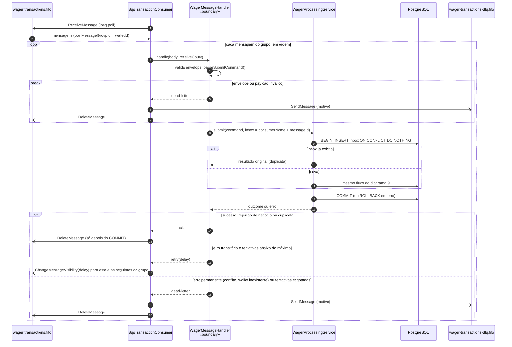

## 11. Sequência: REFUND antes da BET

`par` (p. 290): a BET e o worker andam em paralelo, em instâncias diferentes.

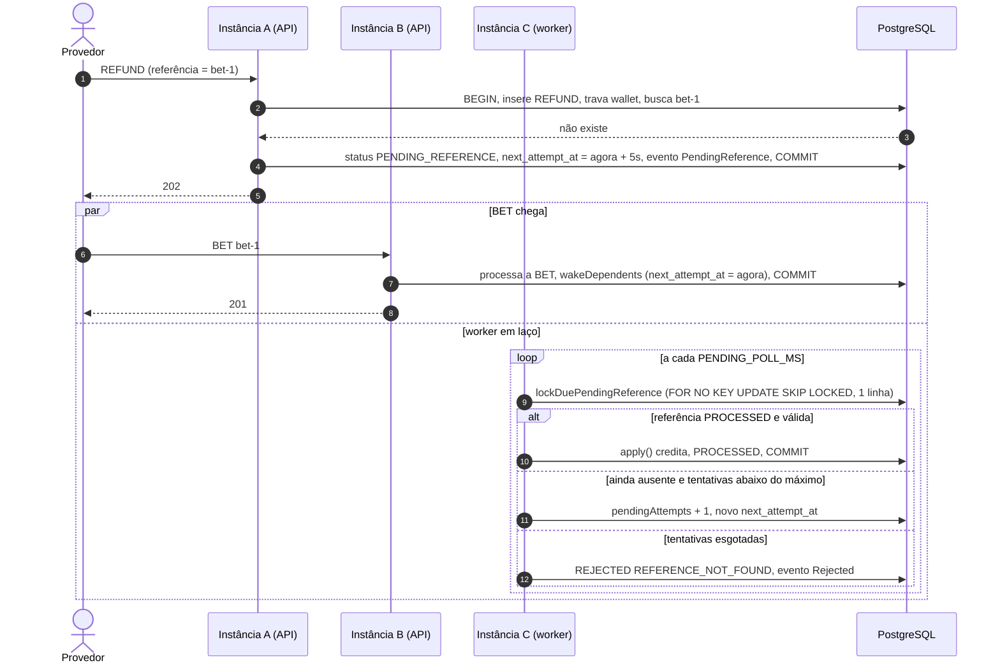

## 12. Sequência: publicar a outbox

Vários publishers ao mesmo tempo (`par`); `SKIP LOCKED` garante que cada evento seja
reivindicado por um só.

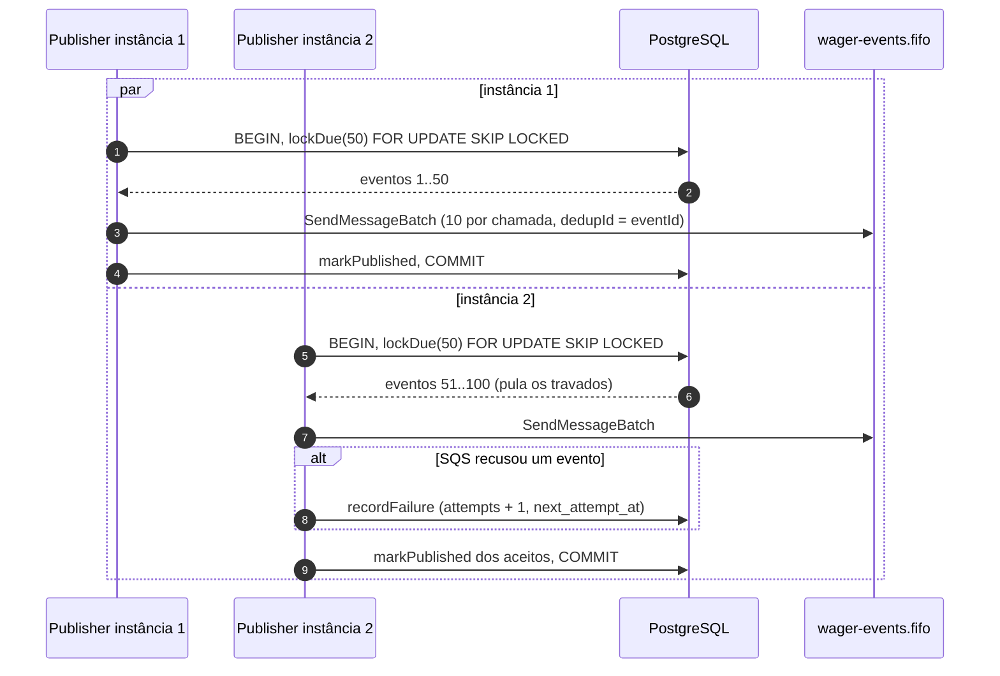

## 13. Atividade com partições: processar uma transação

Cada ação na partição de quem a executa (§10.22). Toda decisão com guarda em todas as saídas
(§10.6). A região interrompível (§10.23) é a transação SQL: até o COMMIT, qualquer falha
desfaz tudo; depois dele, nada volta atrás.

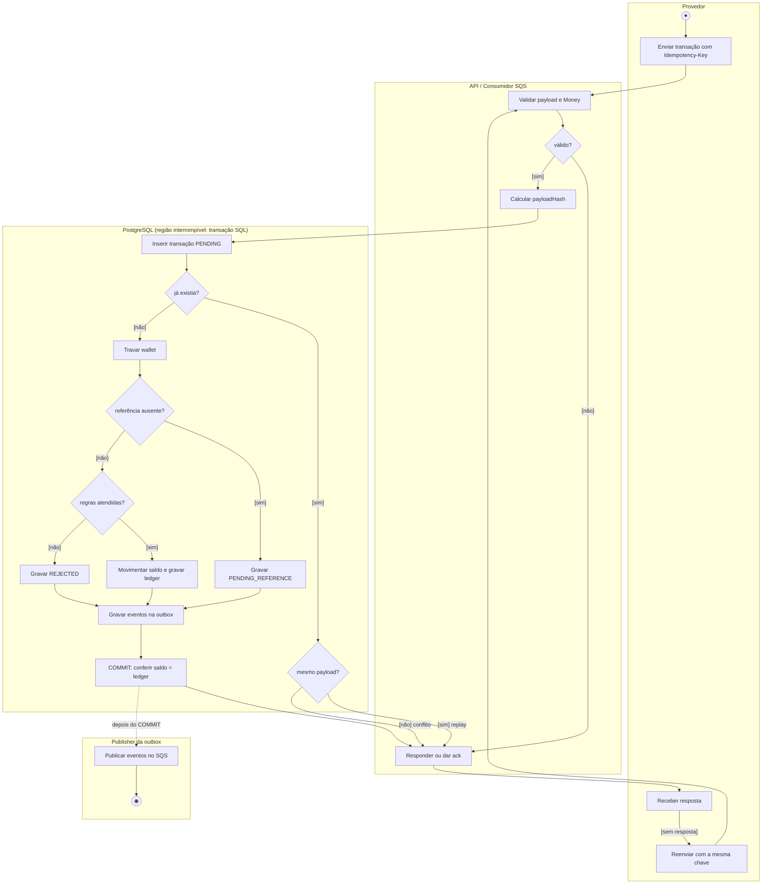

## 14. Componentes

Interfaces fornecidas (bola) e requeridas (soquete) aparecem como rótulos nas ligações
(§12.2).

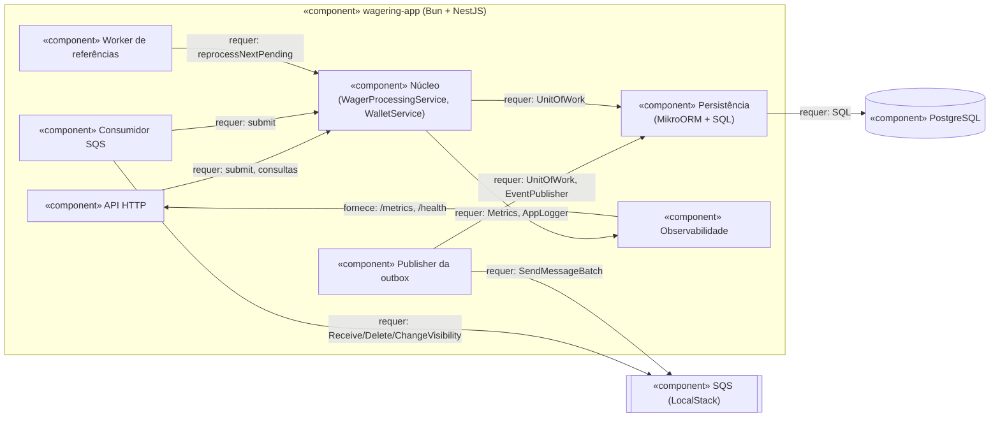

## 15. Implantação

Nós `<<device>>`/`<<executionEnvironment>>` e artefatos (§13.1-13.5), como no
`docker-compose.yml`.

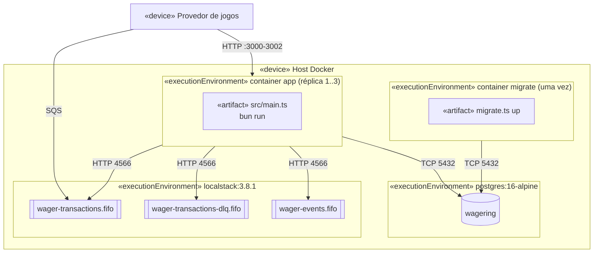

---

## Divergências conhecidas entre modelo e código

Quando o `revisor-uml` achar uma divergência, ela entra aqui até ser corrigida no código ou
no modelo.

| # | Divergência | Evidência | Situação |
|---|---|---|---|
| 1 | A tabela de transições permite `PENDING → FAILED`, mas nenhum caminho do código faz essa transição: na submissão, erro permanente desfaz a transação SQL inteira e a linha `PENDING` some. `FAILED` só é gravado no reprocessamento de `PENDING_REFERENCE` (`markFailed`). | `src/wagering/domain/wager-transaction.ts` (`TRANSITIONS`); `src/application/wager-processing.service.ts` (`markFailed`) | Aberta. Opções: remover `FAILED` das saídas de `PENDING` ou documentar que é reservada. Não afeta a correção financeira. |
